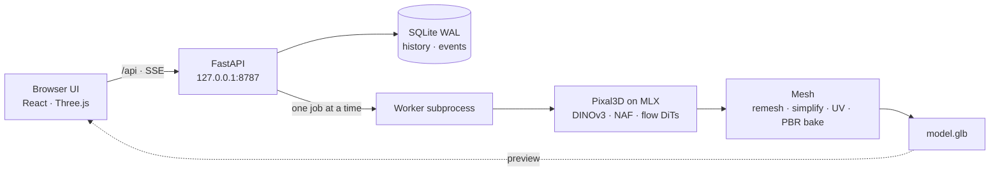

<div align="center">

<picture>
  <source media="(prefers-color-scheme: dark)" srcset="docs/assets/banner-dark.png">
  
</picture>

**[Installation](#installation) · [Usage](#usage) · [How it works](#how-it-works) · [Português](README.pt-BR.md)**


</div>

<p align="center">
  
  <br>
  <sub>Demo image only: a photo of a third-party collectible figure, used to show a result. It is not part of the project and not covered by its license.</sub>
</p>

## Turn one image into a textured 3D model, locally on your Mac.

Pixal is a local studio for [Pixal3D](https://github.com/TencentARC/Pixal3D), Tencent ARC's single-image 3D generator, running on Apple's MLX through the [pixal3d-mlx](https://github.com/lyonsno/pixal3d-mlx) port. It wraps the research pipeline in an app you can leave running: it prepares the weights, runs one generation at a time in an isolated process, shows real progress and hands you a GLB with PBR materials. No cloud, no NVIDIA GPU.

> [!NOTE]
> Unofficial project, not affiliated with Tencent ARC, Meta or Microsoft. The interface is in Portuguese for now.

## Features

- **Image to GLB** - base color, metallic/roughness and normals, validated before the file is published.
- **3D preview** - orbit, zoom, reframe and wireframe as soon as the geometry is extracted, then the textured model.
- **Guided setup** - checks DINOv3 access before any large download, then fetches pinned weights with real byte progress.
- **Queue and history** - one job at a time, cancellation, persistent events and "continue from checkpoint" after the shape stage.
- **Clean meshes** - the surface is rebuilt from its distance field before simplification, so the GLB has no holes or folded sheets.
- **Native settings** - 512 or 1024 (experimental) geometry, 1024/2048 textures, up to 1M faces, seed, steps, guidance and camera.

## Installation

> [!NOTE]
> **Requirements:** macOS on Apple Silicon with Metal · [uv](https://docs.astral.sh/uv/) (installs Python 3.12) · Node.js 22.12+ · 35 GiB free disk (50 GiB recommended; the weights are about 24.7 GiB) · a Hugging Face account.
> Developed and measured on an M5 Pro with 24 GB of memory.

```bash
git clone https://github.com/PHMFG/pixal-studio.git
cd pixal-studio
bash scripts/install.sh
```

The installer syncs the locked Python environment, installs the npm packages and builds the interface. It does not download model weights.

> [!IMPORTANT]
> DINOv3 is a gated model. Request access on its [Hugging Face page](https://huggingface.co/facebook/dinov3-vitl16-pretrain-lvd1689m) and wait for approval before preparing the models. The read token you paste in the app stays in the local Hugging Face cache, never in the browser, history or logs.

## Usage

```bash
npm run start
```

This starts (or reuses) the local server and opens `http://127.0.0.1:8787`. On macOS you can also double-click **Iniciar Pixal.command**.

1. Open **Preparação** once, connect your Hugging Face token if needed and click **Baixar e preparar modelos**.
2. Drop an image of a whole object. To try it, use [`docs/assets/demo-cactus.png`](docs/assets/demo-cactus.png).
3. Pick **1024 · experimental** under *Resolução* for sharper textures on single objects, then click **Gerar objeto**.
4. Watch the stages, sampler steps and log; the preview appears after the geometry is decoded.
5. Click **Baixar GLB**. Every job is also kept in `data/jobs/<id>/model.glb` and in **Histórico**.

On the M5 Pro above, the figure in the screenshots took about 7 minutes at 1024 with 20 steps, a 2048 texture and 500k faces (6,595 tokens, 8.8 GiB peak RSS). Large scenes exceed the 8,192-token limit at 1024 and stop with a clear message; use 512 for them.

<p align="center">
  
</p>

## Screenshots

<details>
<summary>Progress, setup and mobile layout</summary>
<br>

<p align="center">
  
</p>
<p align="center">
  
</p>
<p align="center">
  
</p>

</details>

## How it works



The HTTP server never loads the models: each generation runs in its own process group, writes events to SQLite and can be cancelled or resumed from a shape checkpoint. All data lives in `data/` (change it with `PIXAL_DATA_DIR`), and the server only accepts local hosts and origins.

Development and tests:

```bash
npm run dev
npm run typecheck
uv run pytest tests -q
```

`npm run dev` reuses the API on port 8787 and serves the interface with Vite on `127.0.0.1:5173`. Engine tests need Metal on the host. Design notes, measurements and local changes to the upstream port are in [`docs/`](docs/) (in Portuguese): [status](docs/STATUS.md), [upstream changes](docs/UPSTREAM_CHANGES.md) and [quality investigation](docs/QUALITY_INVESTIGATION.md).

## Roadmap

- [x] Local app with setup wizard, queue, cancellation, history and checkpoint resume
- [x] Image to GLB with PBR textures, normals and validation before publishing
- [x] Remesh-based post-processing: no holes, no folded sheets
- [x] Undistorted square framing for non-square and transparent images
- [x] 1024 cascade (experimental) and 2048 texture atlas
- [ ] Validate 1024 on more images and decide the default resolution
- [ ] Vectorize the sparse decoder (about 115 s of Python loops on large scenes)
- [ ] Sample NAF features only where needed to cut the ~13 GiB MLX peak
- [ ] Per-layer quantization policy and sampling noise independent of model loading
- [ ] Re-run cancel → generate and checkpoint → resume after the mesh rewrite
- [ ] English interface

## License and credits

Pixal is released under the [MIT License](LICENSE). Model weights are not included; they are downloaded from their authors and keep their own licenses.

| Component | Use | License |
| --- | --- | --- |
| [pixal3d-mlx](https://github.com/lyonsno/pixal3d-mlx) | MLX port, vendored with local changes | [MIT](vendor/pixal3d-mlx/LICENSE) |
| [Pixal3D](https://github.com/TencentARC/Pixal3D) | Model and reference pipeline | MIT |
| [TRELLIS.2](https://github.com/microsoft/TRELLIS.2) | Structured-latent architecture and mesh reference | MIT |
| [DINOv3](https://huggingface.co/facebook/dinov3-vitl16-pretrain-lvd1689m) | Image features | DINOv3 License (gated) |
| [NAF](https://github.com/valeoai/NAF) | Feature upsampling | Apache-2.0 |
| [MoGe-2](https://github.com/microsoft/MoGe) via [moge-mlx](https://github.com/lyonsno/moge-mlx) | Camera estimation | MIT |
| [rembg](https://github.com/danielgatis/rembg) with [U²-Net](https://github.com/xuebinqin/U-2-Net) | Background removal | MIT / Apache-2.0 |
| [MLX](https://github.com/ml-explore/mlx) | Inference on Apple Silicon | MIT |
| [React](https://react.dev), [Three.js](https://threejs.org), [react-three-fiber](https://github.com/pmndrs/react-three-fiber) | Interface and 3D preview | MIT |
| [Lucide](https://lucide.dev) | Icons, including the cube in the logo | ISC |

The demo cactus image was drawn for this project and is covered by the project license. The figure in the screenshots comes from a third-party product photo, used only to show a result; its rights belong to their owners.
