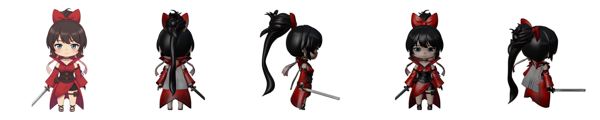
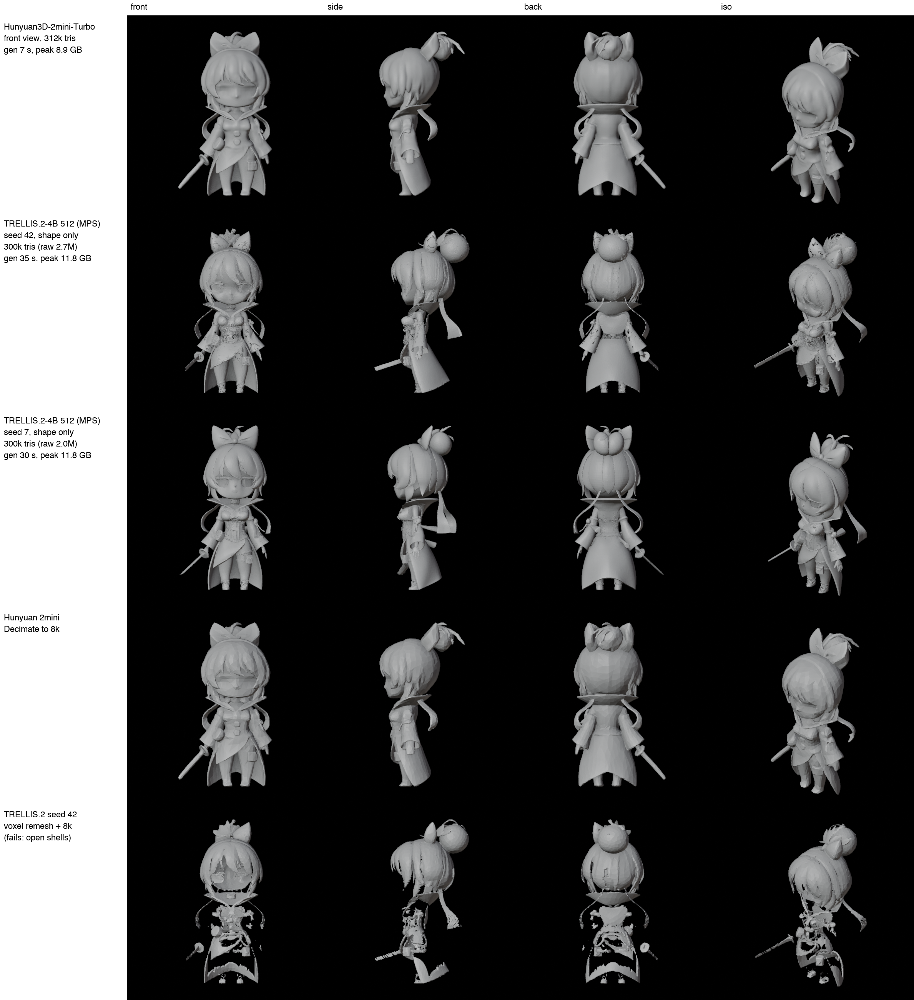
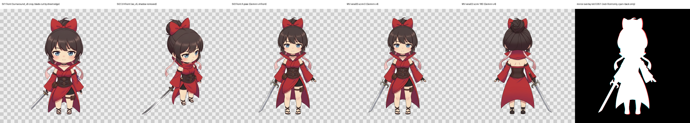
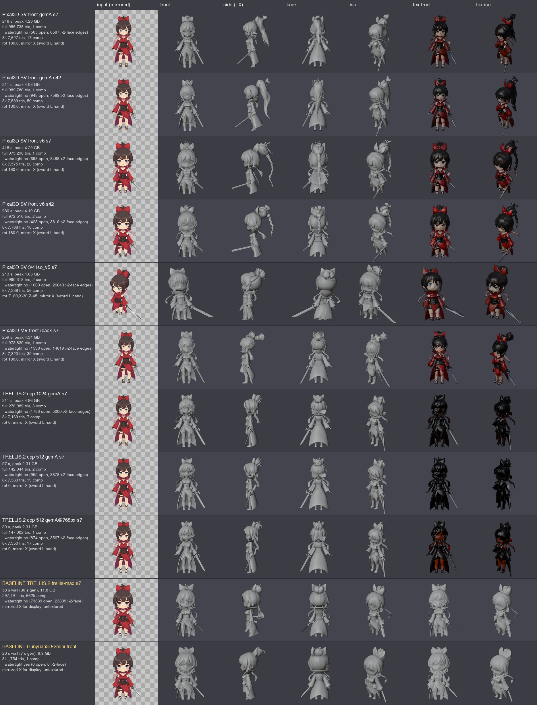
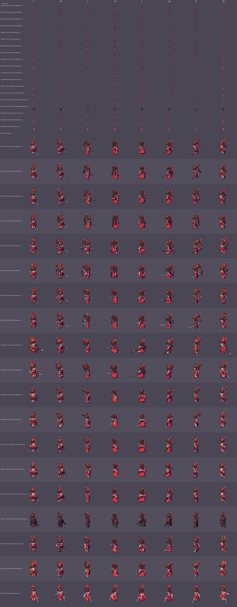
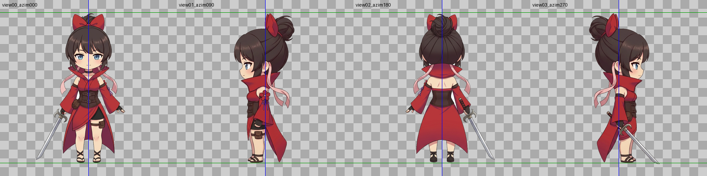
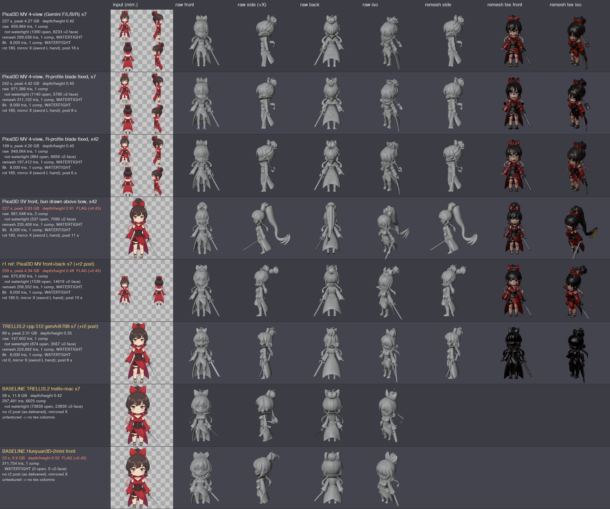
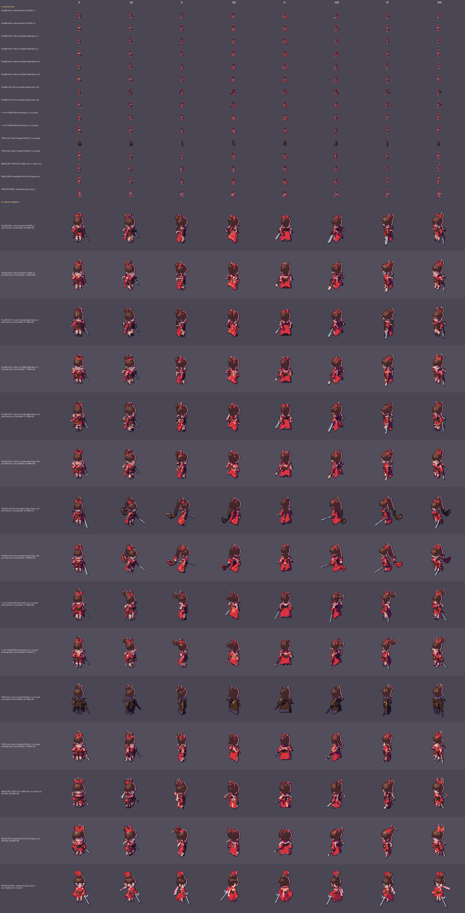

# Pixal3D experiment: does it beat TRELLIS.2 as our pixel-art reference?

Date: 2026-10-24. Machine: Apple M5 Max, 64 GB. Character: Akane, the chibi swordswoman (red dress, red bow on a dark-brunette bun, pink scarf ribbons, brown corset, katana with a crescent-hook guard).

AI meshes are **reference / first draft only**. The procedural Blender rig is still the source of truth.
Background reading: [sota_image_to_3d_2026.md](sota_image_to_3d_2026.md), [trellis_and_hunyuan_studio.md](trellis_and_hunyuan_studio.md), [hunyuan3d_research.md](hunyuan3d_research.md).

## TL;DR

- **Pixal3D with 4 views (front / left / back / right) beats TRELLIS.2** as the 3D reference for body proportions, back and side volumes, hair mass and colour blocking.
  - Best mesh: `mv4_gemfix_s42`.
  - Two of the three judges in round 2 said "yes" outright. The pixel-art lead said "mixed".
- **Pixal3D with a single view loses to TRELLIS.2.** On every input it invents a ponytail or braid (depth/height up to 0.91), so never use it for this character.
- **Neither model is good enough for thin parts.** Katana blade, crescent hook guard, scarf ribbons, collar points and sandal straps all fail, so keep them procedural.
- **Neither model gives a usable pixel-cluster draft.** At 64 px every AI mesh has about 2.5x the orphan pixels of the procedural rig, so draft the sprites from the rig.
- TRELLIS.2 (768 px input, 512 res) is still the cleanest *slim surface* reference, mainly for collar and hem creases. Use it for geometry only, because its texture is near-black on our art.

## 1. Setup route and reproducibility

Full details, including exact commands, commit SHAs, weight table, flags and known issues, are in [`.scratch/pixal3d/SETUP.md`](../.scratch/pixal3d/SETUP.md). The timestamped log is [`.scratch/pixal3d/LOG.md`](../.scratch/pixal3d/LOG.md).

**Route chosen: `raven38/pixal3d.cpp`, the prebuilt Metal binary** (MIT, HEAD `d1b4926452`, release `showcase-assets-sv-1`, sha256 checked).
- It is the only route that runs Pixal3D single-view, Pixal3D multi-view with camera poses, and TRELLIS.2 in one binary.
- It includes the reference hole-fill, remesh and decimation.
- No build was needed, and none of the open issues block Metal.
- Its steps are fixed at 12, and single-view only supports `--res 1024` (it refuses 1536).

**Second option: `pwilkin/trellis.cpp`** (HEAD `83e8080c40`, 2026-10-23). Built from source; it now runs single-view Pixal3D.
- It adds `--faces` and `--steps`, but has no multi-view and no macOS release.
- The build needs the Xcode 26.6 clang with the 26.5 SDK, because the default command-line tools linker can't read the macOS 27 SDK.

**Not used: the MLX ports.** `pixal3d-mlx` has no licence file and has been stale since July.

**Weights:** about 19.4 GB in total, from pinned Hugging Face revisions. Downloads were resumable, and every file matches its sha256 and the published manifest.

| Set | Size | Download time |
|---|---|---|
| Pixal3D single-view q8_0 | 8.09 GB | 13 min |
| Pixal3D multi-view flows | +5.86 GB | 7 min |
| TRELLIS.2 q8 flows | +6.88 GB | 9.5 min |

Files shared between sets (`dinov3`, decoders, `naf`) are hard-linked, not stored twice. Throughput was 14-18 MB/s, with two short throttles that resumed on their own.

**Licences**
- Code (raven38, pwilkin) and the Pixal3D and TRELLIS.2 weights: MIT.
- `dinov3.gguf`: DINOv3 Licence. Commercial use is allowed, but redistribution must include the licence and publications must acknowledge DINO. The licence file is in `weights/pixal3d-sv-q8_0-v1/DINOV3_LICENSE.md`.

**Scripts** are in `.scratch/pixal3d_scripts/`:
- Generation: `fetch_hf.sh`, `run_sv.sh`, `run_mv.sh`, `run_t2.sh`, `run_pw.sh`, `memwatch.sh`, `r1_queue.sh`.
- Mesh processing: `orient_export.py`, `dec_pml.py`, `render_clay.py`, `r1_process.sh`, `r1_baselines.sh`.
- Round 1 sheets and sidecars: `r1_runs.py`, `r1_sheet3d.py`, `r1_sidecars.py`, `r1_sprites.py`, `r1_post.py`.
- Round 2 inputs: `frame4.py`, `blade_fix.py`.
- Judge checks: `lead_verify_stats.py`, `judge_stats.py`, `lead_pixel_counts.py`, `lead_r2_orphans*.py`.

**Conventions**
- Pixal3D outputs face the input camera, so turn them 180° around Z (`render_compare.py ... 0 180`) to show the front.
- All sheet rows are mirrored so the sword is in her left hand.
- Multi-view input is `--views <dir>` with a `transforms.json`: camera FOV in radians, mesh scale, and one 4x4 camera-to-world matrix per frame (frame 0 is the front).
- The multi-view weights are validated for **4 views** (azimuth 0/90/180/270). Two views run with a warning.
- Every heavy run went one at a time and was timed with `/usr/bin/time -l`. Peak memory never went above 10.5 GB, well under the 24 GB budget.

## 2. Setup smoke tests

Input: `.scratch/hunyuan/inputs/front.png`.

| Run | Time | Peak memory | Mesh | Notes |
|---|---|---|---|---|
| Pixal3D single-view, 1024, seed 7, FOV 20° | 262 s (rerun 297 s) | 4.04 GB (4.26 GB) | 972,548 tris | Face, bow, corset, ribbons and katana are kept. It invents a long black ponytail at the back. |
| Pixal3D multi-view, front + back | 354 s | 7.76 GB | 5 pieces | Most of the katana is lost and the bun is doubled. |
| TRELLIS.2, 512 | 102 s | 2.40 GB | — | Dark colour drift. |
| TRELLIS.2, 1024 | 364 s | 7.20 GB | 279,676 tris | Good geometry, near-black texture. |
| Control: TRELLIS.2 1024 on the Pixal3D sample image | 1503 s | 10.52 GB | — | Colours come out right, so the black texture comes from our dark art and is not an engine bug. |

- **Repeatability:** the two seed-7 runs gave identical geometry (same voxel, token and face counts). The output files are not byte-identical.
- **Correction:** the smoke test called the single-view mesh "watertight". The strict check used later (weld vertices, then require 0 open edges and 0 edges shared by 3+ faces) shows it is not.

Earlier baseline for context: 

## 3. Round 1: inputs, runs, sheets

Inputs (in `.scratch/pixal3d/inputs/`):
- `sv_front_gemA.png`: the Gemini front.
- `sv_front_v6.png`: an old turnaround crop with the blade tip cut off.
- `sv_iso34_v5.png`: a 3/4 iso view.
- `mv_fb/`: the Gemini v4 front + back pair with `transforms.json`.

Meshes are in `model/ai_ref/pixal3d/r1/`. Each run has a full mesh and an `-8k` preview.

Table abbreviations:
- **SV** = single-view, **MV** = multi-view, **T2cpp** = TRELLIS.2 on the raven38 engine.
- **Open edges** = edges with only one face. **3+ edges** = edges shared by 3 or more faces.

| Run | Model | Time | Peak memory | Tris | Pieces | Notes |
|---|---|---|---|---|---|---|
| sv_gemA_s7 | Pixal3D SV | 246 s | 4.23 GB | 956,738 | 1 | 565 open edges, 6,587 3+ edges. Good face, bow and katana. Invents a ponytail; hair is black. |
| sv_gemA_s42 | Pixal3D SV | 311 s | 4.08 GB | 982,780 | 1 | Longer ponytail. 948 open edges. |
| sv_v6_s7 | Pixal3D SV | 418 s* | 4.29 GB | 975,298 | 1 | Braided ponytail. The sword sticks out sideways in profile. |
| sv_v6_s42 | Pixal3D SV | 280 s | 4.19 GB | 972,516 | 2 | Bun plus a short braid. Blade is cut off as in the input. |
| sv_iso34_s7 | Pixal3D SV | 243 s | 4.03 GB | 990,318 | 2 | The elevated view breaks the level-camera assumption: body leans and is squat. 26.6k 3+ edges. |
| mv_frontback_s7 | Pixal3D MV, 2 views | 259 s | 4.34 GB | 973,830 | 1 | Full katana and hook guard, no ponytail. Bun is doubled and pushed back; sword lies flat. |
| t2cpp_1024_gemA_s7 | T2cpp | 311 s | 4.86 GB | 278,982 | 3 | Clean geometry. Texture near-black (atlas mean 22/12/11). |
| t2cpp_512_gemA_s7 | T2cpp | 97 s | 2.31 GB | 142,044 | 2 | Black texture, caused by the 1024 px input. |
| t2cpp_512_gemA768_s7 | T2cpp | 89 s | 2.31 GB | 147,002 | 1 | With the input resized to 768 px the texture has colour, though dark. **This is the fair TRELLIS.2 baseline.** |
| baseline trellis-mac | TRELLIS.2 512 | 58 s | 11.8 GB | 297,491 | 6,625 | 73.8k open edges. |
| baseline Hunyuan3D-2mini | Hunyuan | 23 s | 8.9 GB | 311,754 | 1 | The only watertight mesh in round 1. |

\* Slowed by Blender jobs running at the same time.

The sprite sheet shows 8 iso directions at 1x and 4x, run through our camera, toon ramps, palette snap and outline. It has rows coloured from the concept projection and rows coloured from each model's own texture, and ends with the procedural `model_round_7` row.

### Round 1 verdicts

| Judge | Pixal3D beats TRELLIS.2? | Top pick | Key points |
|---|---|---|---|
| Lead 3D technical artist | mixed | mv_frontback_s7 (6.5) | Single-view invents a ponytail, making the mesh about 65% deeper (0.58 vs 0.35). Pixal3D wins clearly on texture colour. |
| Pixel-art lead | mixed | procedural (9), then sv_gemA_s42 (6) | Pixal3D's own texture gives the flattest colour clusters. It also has the most pinholes (73-97 vs 52-56 for T2cpp). |
| Gemini (Argon) | yes | mv_frontback_s7 / sv_gemA_s7 (7) | Better micro-silhouettes and usable colour. The 2-view run flattens the sword and doubles the bun. |

The judges agreed on the next steps:
- Use 4 views.
- Drop elevated input views.
- Repair the meshes (remesh) and fill pinholes in the sprites.
- Keep the thin parts procedural.

## 4. Round 2: 4-view multi-view, post-processing, pinhole fill

**Inputs** (in `.scratch/pixal3d/r2/inputs/`):
- `mv4_gem`: the Gemini v4 front and back, plus a new Gemini side pair. All four were matted and framed with `frame4.py` to the front's scale and sole line. `transforms.json` uses azimuth 0/90/180/270, the same as the upstream sample.
- `mv4_gemfix`: the same set, but in the right profile `blade_fix.py` rotates the blade to vertical about the guard.
- `sv_front_gemBun.png`: a Gemini edit of the front with a big bun drawn above the bow, to test single-view again.

**Round 2 post-processing** for every mesh, including the baselines that were re-run through it:
1. Solidify by 1.5 voxels.
2. Voxel remesh at 0.0045 × height.
3. Drop small islands.
4. Bake the texture at 2048.
5. Decimate to 8k triangles with topology-preserving QEM (quadric edge collapse).

The sprite step adds a pinhole fill. Every `-remesh` and `-8k` output was checked in Blender: one piece, 0 open edges, 0 edges shared by 3+ faces, so they really are **watertight**.

Meshes are in `model/ai_ref/pixal3d/r2/`.

| Run | Time | Peak memory | Raw tris | Raw open / 3+ edges | Depth/height | Notes |
|---|---|---|---|---|---|---|
| mv4_gem_s7 | 227 s | 4.27 GB | 959,984 | 1,090 / 8,233 | 0.40 | One bun, no ponytail. The blade is a thick plank in side and iso views. |
| mv4_gemfix_s7 | 242 s | 4.42 GB | 971,386 | 1,140 / 5,790 | 0.40 | The plank is slightly narrower. |
| **mv4_gemfix_s42** | 199 s | 4.20 GB | 949,064 | 884 / 6,959 | 0.40 | Cleanest round bun and stable against s7. **Best Pixal3D mesh.** Remesh is 197k tris. |
| sv_gemBun_s42 | 227 s | 3.93 GB | 961,548 | — | **0.91** | Fails the ponytail check (depth/height must be ≤ 0.45). The big bun grew into a ponytail down to the hem. |
| t2cpp_512_gemA768_s7 + r2 post | (r1) 89 s | 2.31 GB | 147,002 | 874 / 3,567 | 0.35 | Clean, slim geometry, but texture still near-black. Pinholes 42 → 13 (concept colour), 68 → 26 (own texture). |
| r1 mv_frontback_s7 + r2 post | (r1) 259 s | 4.34 GB | 973,830 | 1,536 / 14,616 | 0.48 | Doubled bun. Pinholes 97 → 20. The remesh alone only reached 83; the pinhole fill did most of the work. |
| trellis-mac + fill | 58 s | 11.8 GB | 297,491 | 73,839 / — | 0.42 | Pinholes 70 → 20. |
| Hunyuan 2mini + fill | 23 s | 8.9 GB | 311,754 | 0 / 0 | 0.52 | Has a ponytail-like bulge. Pinholes 58 → 20. |

The Blender check also found that raw Pixal3D meshes are **not** one piece when pieces are counted by shared edges: mv4_gemfix_s42 has 51 pieces (the main one holds 99.7% of the triangles) and mv4_gem_s7 has 108. The earlier "1 piece" figures counted pieces joined only at a shared vertex. The round 2 post-processing fixes this, so it is mandatory.

### Round 2 verdicts

| Judge | Pixal3D beats TRELLIS.2? | Ranking (top) | Scores |
|---|---|---|---|
| Lead 3D technical artist | **yes** | mv4_gemfix_s42 > mv4_gemfix_s7 > mv4_gem_s7 > t2cpp | 7.5 / 7 / 6.5 / 5.5; sv_gemBun 2 |
| Pixel-art lead | mixed | procedural > mv4_gemfix_s42 > mv4_gemfix_s7 > Hunyuan > t2cpp | 8 / 6 / 5.5 / 5 / 5; sv_gemBun 2 |
| Gemini (Argon) | **yes** | mv4_gemfix_s42 > mv4_gemfix_s7 > mv4_gem_s7 > r1 2-view > trellis-mac > t2cpp | 7 / 6.8 / 6.5 / 5.8 / 5.2 / 4.8 |

**What the judges agree on**
- 4-view Pixal3D gets the back of the head right: one round bun high at the back, no ponytail, no doubled bun.
  - Head-band depth/height is 0.36-0.40, and the top band is 0.20-0.22.
  - The result is stable across seeds: s7 and s42 match to within 0.01-0.03.
  - It gives the best back and 3/4-back reads (N, NE, NW): a solid red dress block with a clean hem.
- Legs are separate, the colour blocks are readable, and the texture works.
- The katana is a plank in every run and the hook guard is lost at 64 px. Ribbons and collar come out thick and rubbery. The bow is undersized and fused with the bun.

**Pixel-art lead's counts**
- Orphan pixels (tolerance 48, over 8 directions): mv4 s42 393 (texture) / 513 (concept colour), T2cpp 423, trellis-mac 366, Hunyuan 406, procedural **162**.
- So at pixel level the AI meshes are all about equally noisy, and none of them is a cluster-level draft.
- The torso texture is mottled, and the bangs hide the eyes when the model's own texture is used.

## 5. Conclusion

**Does Pixal3D beat TRELLIS.2?** Yes, as the 3D reference / first draft, **but only in 4-view mode** (`mv4_gemfix_s42`). In single-view it is clearly worse because of the invented hair. At sprite-pixel level the two are about equal, and the procedural rig is far ahead of both.

**How to use each model, by part:**

| Part | Use |
|---|---|
| Overall proportions, head/body ratio, dress flare, back and side volumes | **Pixal3D 4-view** (`best/…mv4_gemfix_s42-r1024-remesh.glb`) |
| Bun and back-of-head mass, hair silhouette | **Pixal3D 4-view.** Use head-band depth/height (top 0.20-0.22, head 0.36-0.40) as a regression check for the rig. |
| Colour blocking (dress, corset, skin, bow placement) for back and 3/4-back views | **Pixal3D's own texture.** Sample hair colour from the concept, because the generated hair is black. |
| Face | **Procedural rig / concept.** Not either AI model: the bangs hide the eyes. |
| Slim surface creases (collar, corset, hem), clean geometry | **TRELLIS.2 cpp, 768 px input at 512 res** (`best/…trellis2cpp…-remesh.glb`), geometry only, with concept-projected colour |
| Katana and crescent hook guard, scarf ribbons, collar points, sandal straps, bow loops | **Procedural only.** Take at most attachment points from the AI mesh. |
| 64 px sprite draft | **Procedural rig (round 7).** The AI sprites are only useful as colour-placement hints. |

**Rules for future runs**
- Use 4 level views at FOV 20.
- Fix the blade in the profile view, or better, inpaint the katana and ribbons out of all four inputs.
- Always apply the round 2 post-processing and the pinhole fill.
- Reject any single-view result with depth/height above 0.45.
- For TRELLIS.2, feed a 768 px input at 512 res, or use 1024 with `--no-texture`.

**Ideas worth trying next**
- 6 views (adding azimuths 45 and 315) for the 3/4 silhouettes and ribbons.
- Enlarging the bow about 1.3x in the inputs.
- A per-part palette-ID pass with a mode filter before quantising, to get under 250 orphan pixels per 8 directions.

**Still open:** the root cause of the black TRELLIS.2 texture. It is linked to dark art and 1024 px input, and it happens on both engines.

## 6. Final meshes

The final meshes are in `model/ai_ref/pixal3d/best/` (87 MB):
- `akane_pixal3d_mv4_gemfix_s42-r1024-full.glb` (raw), `-remesh.glb` (197k tris, watertight), `-8k.glb` (watertight), `.txt` (stats) and `-transforms.json` (camera poses).
- `akane_trellis2cpp_4b512_frontgemA768_s7-remesh.glb` and `-8k.glb`, plus `.txt`: the TRELLIS.2 geometry companion.

## 7. Disk usage and cleanup

`.scratch/pixal3d/` takes about 23 GB in total. `model/ai_ref/pixal3d/` takes 713 MB: r1 255 MB, r2 371 MB, best 87 MB.

| Path | Size | Can be deleted? |
|---|---|---|
| `weights/pixal3d-sv-q8_0-v1` | 8.09 GB (5.86 GB unique flows + 2.2 GB shared files, hard-linked) | Optional. Single-view is not recommended for Akane, but keep it while the shared files are needed. Deleting it frees 5.86 GB. |
| `weights/pixal3d-q8_0-v1` (multi-view) | 5.86 GB unique | **Keep.** This is the recommended mode. |
| `weights/trellis2-gguf-q8` | 6.88 GB unique | Keep if we want the same-engine TRELLIS.2 geometry, otherwise delete. Deleting it frees 6.88 GB. |
| `trellis2_same_engine/` | 1.1 GB | Mostly yes: the debug run, the control run and the raw `.ply` files (about 1 GB). |
| `trellis2_pwilkin/` + `build_trellis_cpp/` + `src_trellis_cpp/` | 460 MB + 45 MB + 245 MB | Yes, unless we want the pwilkin `--steps`/`--faces` option. |
| `smoke/`, `mv_frontback/` | 364 MB + 350 MB | Yes. Superseded by r1/r2, and the sheets are already copied to `docs/img`. |
| `r1/`, `r2/` working directories | 617 MB + 496 MB | Mostly yes. Keep `r2/inputs` and `r2/stats`. The final meshes are already under `model/ai_ref/pixal3d/`. |
| `rel_metal/` (binary), `src_pixal3d_mv_example/`, `inputs/` | 9 MB + 4 MB + 29 MB | **Keep.** Small, and needed to reproduce the runs. |
| `model/ai_ref/pixal3d/r1/` | 255 MB | Can be deleted once this report is accepted. Round 2 and `best/` supersede it. |

Removing everything except the multi-view weights (and the shared files they need), the binary, the inputs and `best/` frees about **15 GB**. The older `.scratch/hunyuan` (11 GB) and `.scratch/trellis` (9.9 GB) are outside this experiment and were left untouched.
